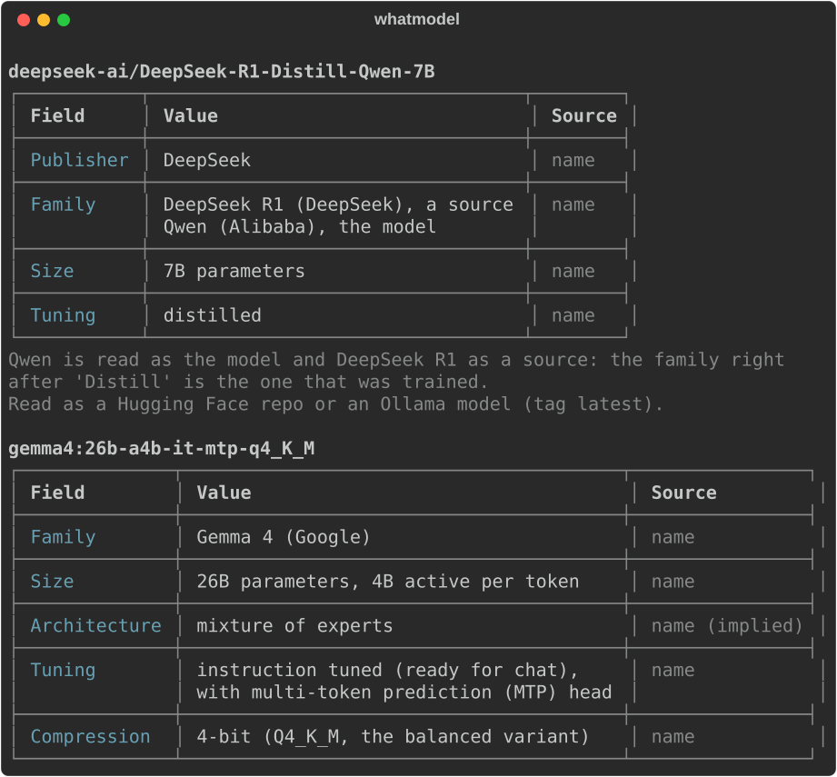

# whatmodel

[](https://github.com/ShekharBhardwaj/whatmodel/actions/workflows/release.yml)

Explain LLM model names in plain English: give it `gemma4:e2b-it-qat` and it tells you what each part means, plus the facts the name leaves out.

It reads names from Ollama, Hugging Face and GGUF files. There are no LLM calls: every explanation comes from a plain data file and from model metadata.



## Install

```bash
uv tool install whatmodel
```

Or run it once without installing:

```bash
uvx whatmodel qwen3.5:4b
```

`pip install whatmodel` works too. Python 3.10 or newer.

## Examples

The outputs below are pasted from real runs.

### An Ollama name

```console
$ whatmodel gemma4:e2b-it-qat

gemma4:e2b-it-qat
┌──────────────┬────────────────────────────────────┬──────────────┐
│ Field        │ Value                              │ Source       │
├──────────────┼────────────────────────────────────┼──────────────┤
│ Family       │ Gemma 4 (Google)                   │ name         │
├──────────────┼────────────────────────────────────┼──────────────┤
│ Size         │ effective 2B parameters            │ name         │
├──────────────┼────────────────────────────────────┼──────────────┤
│ Tuning       │ instruction tuned (ready for chat) │ name         │
├──────────────┼────────────────────────────────────┼──────────────┤
│ Compression  │ quantization-aware trained         │ name         │
├──────────────┼────────────────────────────────────┼──────────────┤
│ Runs         │ locally, installed in Ollama here  │ local Ollama │
├──────────────┼────────────────────────────────────┼──────────────┤
│ Parameters   │ 4.6B                               │ local Ollama │
├──────────────┼────────────────────────────────────┼──────────────┤
│ Compression  │ 4-bit (Q4_0)                       │ local Ollama │
├──────────────┼────────────────────────────────────┼──────────────┤
│ Architecture │ dense                              │ local Ollama │
├──────────────┼────────────────────────────────────┼──────────────┤
│ Context      │ 128k tokens                        │ local Ollama │
├──────────────┼────────────────────────────────────┼──────────────┤
│ Tools        │ yes                                │ local Ollama │
├──────────────┼────────────────────────────────────┼──────────────┤
│ Vision       │ yes                                │ local Ollama │
├──────────────┼────────────────────────────────────┼──────────────┤
│ Thinking     │ yes                                │ local Ollama │
├──────────────┼────────────────────────────────────┼──────────────┤
│ License      │ Apache License, Version 2.0        │ local Ollama │
├──────────────┼────────────────────────────────────┼──────────────┤
│ File size    │ 4.3 GB                             │ local Ollama │
└──────────────┴────────────────────────────────────┴──────────────┘
```

The Source column says where each row came from: `name` rows are read from the name alone, and the rest are looked up, here from the Ollama running on the same machine.

### A Hugging Face repo

```console
$ whatmodel bartowski/Qwen_Qwen3-30B-A3B-GGUF

bartowski/Qwen_Qwen3-30B-A3B-GGUF
┌──────────────┬────────────────────────────────────────────┬──────────────┐
│ Field        │ Value                                      │ Source       │
├──────────────┼────────────────────────────────────────────┼──────────────┤
│ Publisher    │ bartowski (community GGUF conversions)     │ name         │
├──────────────┼────────────────────────────────────────────┼──────────────┤
│ Family       │ Qwen 3 (Alibaba)                           │ name         │
├──────────────┼────────────────────────────────────────────┼──────────────┤
│ Size         │ 30B parameters, 3B active per token        │ name         │
├──────────────┼────────────────────────────────────────────┼──────────────┤
│ Architecture │ mixture of experts                         │ name         │
├──────────────┼────────────────────────────────────────────┼──────────────┤
│ Format       │ GGUF (for llama.cpp, Ollama and LM Studio) │ name         │
├──────────────┼────────────────────────────────────────────┼──────────────┤
│ Parameters   │ 30.5B                                      │ Hugging Face │
├──────────────┼────────────────────────────────────────────┼──────────────┤
│ Context      │ 32k tokens                                 │ Hugging Face │
├──────────────┼────────────────────────────────────────────┼──────────────┤
│ Tools        │ yes (judged from the chat template)        │ Hugging Face │
├──────────────┼────────────────────────────────────────────┼──────────────┤
│ License      │ apache-2.0                                 │ Hugging Face │
├──────────────┼────────────────────────────────────────────┼──────────────┤
│ File size    │ 8.1 GB to 39.7 GB, 28 GGUF files           │ Hugging Face │
└──────────────┴────────────────────────────────────────────┴──────────────┘
```

### A GGUF file name

```console
$ whatmodel Llama-3-8B-Instruct.Q4_K_M.gguf

Llama-3-8B-Instruct.Q4_K_M.gguf
┌─────────────┬────────────────────────────────────────────┬────────┐
│ Field       │ Value                                      │ Source │
├─────────────┼────────────────────────────────────────────┼────────┤
│ Family      │ Llama 3 (Meta)                             │ name   │
├─────────────┼────────────────────────────────────────────┼────────┤
│ Size        │ 8B parameters                              │ name   │
├─────────────┼────────────────────────────────────────────┼────────┤
│ Tuning      │ instruction tuned (ready for chat)         │ name   │
├─────────────┼────────────────────────────────────────────┼────────┤
│ Compression │ 4-bit (Q4_K_M, the balanced variant)       │ name   │
├─────────────┼────────────────────────────────────────────┼────────┤
│ Format      │ GGUF (for llama.cpp, Ollama and LM Studio) │ name   │
└─────────────┴────────────────────────────────────────────┴────────┘
```

This name has no file behind it, so every row comes from the name. Give the path to a real GGUF file and its header is read as well.

## Usage

```text
whatmodel <name>              explain one name
whatmodel <name> <name>...    explain several
whatmodel -                   read names from standard input, one per line
whatmodel compare <a> <b>     put names side by side and mark what differs
whatmodel list                explain every model installed in local Ollama
whatmodel tokens              print the token dictionary
whatmodel mcp                 run as an MCP server for AI assistants
```

| Flag | What it does |
|---|---|
| `--json` | Print JSON. One name gives an object, several names give a list. |
| `--offline` | Make no network requests. A GGUF file on your machine is still read. |
| `--ollama-url URL` | Where Ollama listens. Defaults to `http://localhost:11434`, or `OLLAMA_HOST` if set. |
| `--verbose`, `-v` | Add a column with a one-sentence explanation of each row. |
| `--brief`, `-b` | Print one row per model instead of a table each. |
| `--no-cache` | Do not reuse or save Hugging Face and OpenRouter answers on disk. |
| `--version` | Print the version. |

Accepted name formats:

- Ollama: `[host/][namespace/]model[:tag]`, for example `qwen3.5:4b` or `hf.co/bartowski/Qwen_Qwen3-30B-A3B-GGUF:Q4_K_M`
- Hugging Face: `org/repo`, or a pasted `https://huggingface.co/org/repo` link
- File names: `Llama-3-8B-Instruct.Q4_K_M.gguf`, with or without a folder in front. If the file exists on your machine, its header is read too.
- Hosted API model IDs: `gpt-4o-2024-08-06` or `claude-3-5-sonnet-20241022`. A name is read this way only when every family in it is offered solely as a hosted service.
- OpenRouter IDs: `anthropic/claude-3.5-sonnet:free`, recognized by an OpenRouter-only tag such as `free` or `nitro`

Piping works with `ollama list`, because only the first column of each line is read:

```bash
ollama list | whatmodel - --brief
```

A model that happens to be called `list`, `compare` or `tokens` can be explained with `whatmodel explain list`.

### Many names at once

`--brief` prints one row per model, which suits a long list:

```console
$ whatmodel gemma4:e2b-it-qat llama3.1:8b-instruct-q4_K_M qwen3.5:4b --offline --brief

┌─────────────────────────────┬────────────────────────────────────┬───────────┐
│ Name                        │ From the name                      │ Looked up │
├─────────────────────────────┼────────────────────────────────────┼───────────┤
│ gemma4:e2b-it-qat           │ Gemma 4 (Google); effective 2B     │ -         │
│                             │ parameters; instruction tuned      │           │
│                             │ (ready for chat);                  │           │
│                             │ quantization-aware trained         │           │
├─────────────────────────────┼────────────────────────────────────┼───────────┤
│ llama3.1:8b-instruct-q4_K_M │ Llama 3.1 (Meta); 8B parameters;   │ -         │
│                             │ instruction tuned (ready for       │           │
│                             │ chat); 4-bit (Q4_K_M, the balanced │           │
│                             │ variant)                           │           │
├─────────────────────────────┼────────────────────────────────────┼───────────┤
│ qwen3.5:4b                  │ Qwen 3.5 (Alibaba); 4B parameters  │ -         │
└─────────────────────────────┴────────────────────────────────────┴───────────┘
```

### Comparing names

```console
$ whatmodel compare llama3.1:8b-instruct-q4_K_M llama3.1:8b-instruct-q5_K_M --offline

┌─────────────┬──────────────────────────┬───────────────────────────┬─────────┐
│             │ llama3.1:8b-instruct-q4_ │ llama3.1:8b-instruct-q5_K │         │
│ Field       │ K_M                      │ _M                        │ Same?   │
├─────────────┼──────────────────────────┼───────────────────────────┼─────────┤
│ Family      │ Llama 3.1 (Meta)         │ Llama 3.1 (Meta)          │ same    │
├─────────────┼──────────────────────────┼───────────────────────────┼─────────┤
│ Size        │ 8B parameters            │ 8B parameters             │ same    │
├─────────────┼──────────────────────────┼───────────────────────────┼─────────┤
│ Tuning      │ instruction tuned (ready │ instruction tuned (ready  │ same    │
│             │ for chat)                │ for chat)                 │         │
├─────────────┼──────────────────────────┼───────────────────────────┼─────────┤
│ Compression │ 4-bit (Q4_K_M, the       │ 5-bit (Q5_K_M, the        │ differs │
│             │ balanced variant)        │ balanced variant)         │         │
└─────────────┴──────────────────────────┴───────────────────────────┴─────────┘
Every row is read from the names. Nothing was looked up.
```

Without `--offline` the looked-up facts are compared too, below a divider. `--json` gives the same rows as data.

### Unknown and ambiguous tokens

whatmodel never guesses. A token that is not in its dictionary is reported as unknown, with a link that opens a prefilled GitHub issue so you can report what it means. A token with two possible meanings is shown with both:

```console
$ whatmodel qwen-max-0725 --offline

qwen-max-0725
┌───────────┬───────────────────────────────────────┬────────┐
│ Field     │ Value                                 │ Source │
├───────────┼───────────────────────────────────────┼────────┤
│ Family    │ Qwen (Alibaba)                        │ name   │
├───────────┼───────────────────────────────────────┼────────┤
│ Tier      │ max tier (the most capable option)    │ name   │
├───────────┼───────────────────────────────────────┼────────┤
│ Ambiguous │ 0725: dated 07-25 (month-day) [build] │ name   │
│           │ or released 2025-07 [build]           │        │
└───────────┴───────────────────────────────────────┴────────┘
No tag in the name. Pulled with Ollama, it would mean latest.
```

The same rule covers what a name leaves out. A name alone cannot show where a model runs or which build you would get, so whatmodel adds a Runs row only when the name says so (a `cloud` tag, or a family that is only offered as a hosted service) or a lookup confirms it.

The same applies to a name such as `org/model` with no tag, which fits both a Hugging Face repo and an Ollama model. Both readings are named unless a lookup settles which one it is.

### Names with two families

Fine-tunes and distillations often name two model families. whatmodel says which one is the model only when the name settles it:

```console
$ whatmodel deepseek-ai/DeepSeek-R1-Distill-Qwen-7B --offline

deepseek-ai/DeepSeek-R1-Distill-Qwen-7B
┌───────────┬──────────────────────────────────┬────────┐
│ Field     │ Value                            │ Source │
├───────────┼──────────────────────────────────┼────────┤
│ Publisher │ DeepSeek                         │ name   │
├───────────┼──────────────────────────────────┼────────┤
│ Family    │ DeepSeek R1 (DeepSeek), a source │ name   │
│           │ Qwen (Alibaba), the model        │        │
├───────────┼──────────────────────────────────┼────────┤
│ Size      │ 7B parameters                    │ name   │
├───────────┼──────────────────────────────────┼────────┤
│ Tuning    │ distilled                        │ name   │
└───────────┴──────────────────────────────────┴────────┘
Qwen is read as the model and DeepSeek R1 as a source: the family right after
'Distill' is the one that was trained.
Read as a Hugging Face repo or an Ollama model (tag latest).
```

Two rules are used. The family right after `Distill` is the one that was trained. A family that is only offered as a hosted service, such as Claude, has no weights to share, so it is read as a source. When neither rule applies, the output says the name leaves it open.

### Where the facts come from

The lookup step tries these sources and merges them:

1. The GGUF file itself, when the name is a path to a file on your machine. Only the header is read, never the weights, so it takes a fraction of a second on a file of any size.
2. The local Ollama API (`/api/show` and `/api/tags`), for models you have installed.
3. The Hugging Face Hub API, for names that contain `org/repo`.
4. OpenRouter's public model list, for OpenRouter IDs and hosted API IDs with a publisher, such as `anthropic/claude-3.5-sonnet`. The whole list is fetched, so the name you typed is never sent.

A **Based on** row names the model a repo or file was made from, when its model card or header says so. On Hugging Face it also says how: a compressed copy, a fine-tune, an adapter or a merge.

Timeouts are short. A source that is offline, slow, or does not know the model is skipped, and the name is still explained. In JSON every item carries a `source` of `name`, `implied`, `file`, `ollama`, `huggingface` or `openrouter`, and `lookups` reports what happened with each source.

Hugging Face and OpenRouter answers are saved on disk for a day, so repeated lookups are instant and still work without a network connection. A note under the table says when a saved copy was used. `--no-cache` turns this off, and `WHATMODEL_CACHE_DIR` moves the folder. Ollama answers are never cached. As a library, `explain()` caches only when you pass `cache_dir`.

A Source of `name (implied)` marks a row that no token states outright but another token settles. `A3B` (3B active parameters) implies a mixture-of-experts design, for example. Run with `-v` to see the reason.

## Library

```python
import whatmodel

parsed = whatmodel.parse("llama3.1:8b-instruct-q4_K_M")  # the name only, no network
parsed.family, parsed.version, parsed.size  # ('llama', '3.1', '8B')
parsed.parameters  # 8000000000
parsed.unknown  # tokens the dictionary does not know
print(parsed)  # Llama 3.1 (Meta); 8B parameters; instruction tuned (ready for chat); ...

info = whatmodel.explain("qwen3.5:4b")  # the name plus lookups
info.family, info.size  # what the name says: ('qwen', '4B')
info.context_length, info.supports_tools  # looked up: (262144, True)
info.quantization, info.parameter_count  # looked up if possible, else from the name
print(info)  # plain text, one line per field
info.to_dict()  # the same data --json prints
```

`explain(name, offline=True)` makes no requests at all. A looked-up field such as `context_length` or `supports_tools` is `None` when nothing was found, which is different from `False`.

With [rich](https://github.com/Textualize/rich) installed, `rich.print(info)` draws the same table the command line prints.

More helpers:

```python
whatmodel.explain_many(["gemma4:12b", "llama3:8b"])  # several names, one connection

result = whatmodel.compare("llama3.1:8b-instruct-q4_K_M", "llama3.1:8b-instruct-q5_K_M")
[(f.field, f.values) for f in result.differences]
# [('Compression', ('4-bit (Q4_K_M, the balanced variant)', '5-bit (Q5_K_M, the balanced variant)'))]

[r.label for r in whatmodel.meanings("qat")]  # ['quantization-aware trained']
whatmodel.meanings("zzz")  # () for a token it does not know

parsed.family_roles  # {'qwen': 'model', 'claude': 'source'} when a name has two families
```

`import whatmodel` is light: the HTTP and table libraries load only when a lookup or a table needs them.

## With AI assistants (MCP)

`whatmodel mcp` runs whatmodel as a [Model Context Protocol](https://modelcontextprotocol.io) server, so an AI assistant can look up a model name while it works. It offers two tools, `explain_model_name` and `compare_model_names`, and needs nothing extra installed.

For a client configured with JSON, such as Claude Desktop:

```json
{
  "mcpServers": {
    "whatmodel": { "command": "whatmodel", "args": ["mcp"] }
  }
}
```

For Claude Code:

```bash
claude mcp add whatmodel -- whatmodel mcp
```

Each tool takes `lookup: false` to read the name only, with no network use.

## In the browser

[docs/index.html](https://github.com/ShekharBhardwaj/whatmodel/blob/main/docs/index.html) is a single page that runs the same name reader in the browser, with no server and nothing sent anywhere. Served with GitHub Pages it lives at <https://shekharbhardwaj.github.io/whatmodel/>. It reads names only and makes no lookups.

## Coverage

Measured on 5,918 popular Ollama and Hugging Face names on 2026-11-12, whatmodel read 81% of names with no unknown token, and knew 96% of all tokens. New model families appear every week, so the rest are reported as unknown until someone adds them. A weekly workflow repeats the measurement on fresh names and keeps an issue titled "Token coverage report" up to date with the most common unknown tokens. `scripts/fetch_names.py` and `scripts/coverage.py` run the same thing by hand.

## What the name cannot tell you

A model name is a label chosen by whoever published it. Even a fully understood name leaves these open, which is what the lookup step is for:

- **The exact compression.** `qat` says how a model was trained, not how many bits it uses. A bare tag such as `:4b` says nothing about compression at all.
- **What `latest` points to.** It is a moving pointer. The size and compression behind it can change.
- **The real parameter count.** `4b` is a rounded label. The model above is called `e2b` and has 4.6 billion parameters.
- **Context length.** Rarely in the name, and the usable value also depends on how the model is run.
- **Capabilities.** Tool calling, vision and thinking are usually not in the name.
- **The license.** Never in the name.
- **Who trained it.** The publisher in `org/repo` is often a third party who converted the model.
- **File size and memory needs.** These depend on compression and format. whatmodel reports file size when a source has it and does not estimate whether a model fits your hardware.

And some things no lookup settles: a name does not tell you how good a model is.

## Adding a token

Every meaning whatmodel knows lives in one file, [`whatmodel/tokens.yaml`](https://github.com/ShekharBhardwaj/whatmodel/blob/main/whatmodel/tokens.yaml). No Python is needed to teach it a new token:

```yaml
- pattern: olmo
  category: family
  label: OLMo
  maker: Allen Institute for AI
  explanation: The open language model family from the Allen Institute for AI.
```

Then check it:

```bash
uv run pytest
uv run whatmodel olmo-2:7b --offline
```

### Your own tokens

To teach whatmodel names that only you use, such as internal model names, put entries in your own file. It is merged over the built-in dictionary, and where both give a token a meaning, yours wins.

| System | Path |
|---|---|
| macOS and Linux | `~/.config/whatmodel/tokens.yaml` |
| Windows | `%APPDATA%\whatmodel\tokens.yaml` |

`WHATMODEL_TOKENS` points to a different file. The format is the same, and only `schema` and `tokens` are needed:

```yaml
schema: 1
tokens:
  - pattern: acme
    category: family
    label: Acme Assistant
    maker: Acme Corp
    explanation: Our in-house fine-tunes.
```

Output that used one of your entries says so under the table, and `whatmodel tokens` marks them. A mistake in the file is reported once and the file is left out, so it never stops a name from being explained.

[CONTRIBUTING.md](https://github.com/ShekharBhardwaj/whatmodel/blob/main/CONTRIBUTING.md) covers patterns, regex entries and the rules entries must follow.

## License

MIT. See [LICENSE](https://github.com/ShekharBhardwaj/whatmodel/blob/main/LICENSE).
